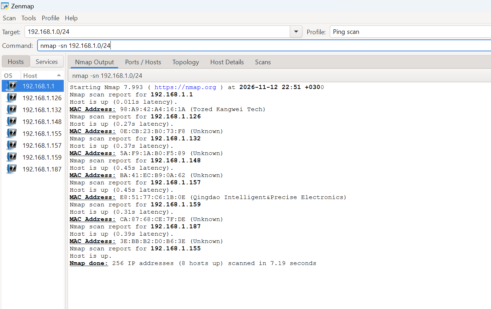
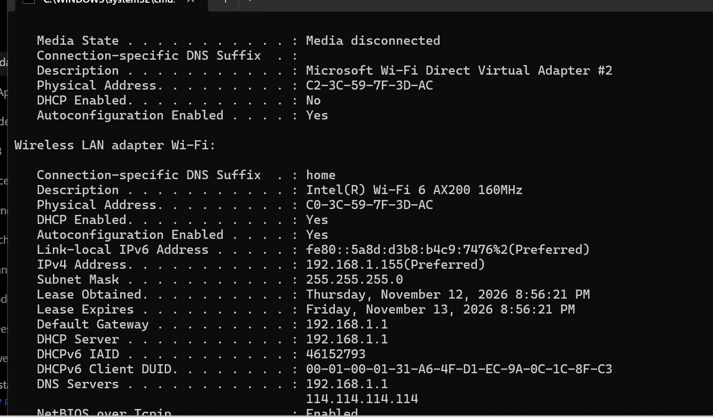
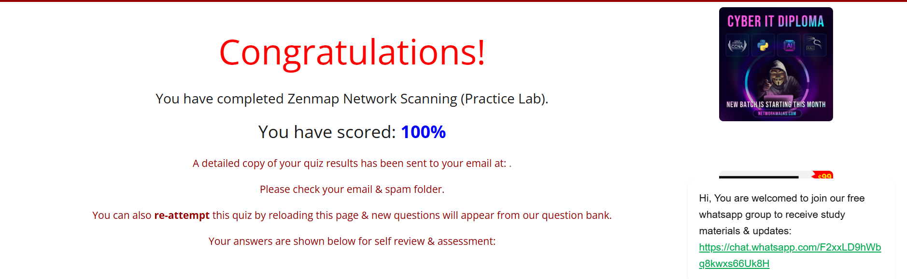
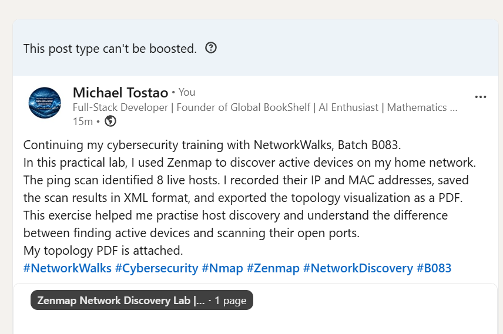

# NETWORKWALKS-MICHAEL-B083-WK2-FOOTPRINTING-NETWORK-SCANNING
NetworkWalks Week 2 coursework: mathematics PDF searches, Zenmap host discovery, report, and supporting evidence. Batch B083.
# Week 2: Footprinting and Network Scanning

**Student:** Michael Tostao Paul  
**Batch:** B083  
**Course:** NetworkWalks Cybersecurity  
**Submission date:** 13 November 2026

## Completion status

| Task | Status |
|---|---|
| PM2 Task 1: Camera discovery | Incomplete |
| PM2 Task 2: Mathematics PDF searches | Completed |
| PM5: Zenmap network discovery | Completed |
| Zenmap practice quiz | Completed — 100% |
| Report and supporting evidence | Included |

This is a partial Week 2 submission. PM2 is not fully complete because its camera discovery task remains unfinished.

## Report and scan files

- [Read the report (PDF)](Michael_B083_Week2_Report.pdf)
- [Download the editable report (Word)](Michael_B083_Week2_Report.docx)
- [Zenmap scan results (XML)](Michael_B083_Zenmap_Scan.xml)
- [Network topology (PDF)](Michael_B083_Zenmap_Topology.pdf)

## PM2: Mathematics PDF searches

I used Google search operators, including `site:` and `filetype:pdf`, to locate mathematics PDFs.

I recorded ten PDF links and the search queries used to find them. The full records are included in the report. These resources did not require login credentials.

## PM5: Zenmap host discovery

I performed this exercise on my own home Wi-Fi network.

### Procedure

1. Used `ipconfig /all` to identify my Wi-Fi IPv4 address, subnet mask, and default gateway.
2. Opened Zenmap and selected the Ping scan profile.
3. Entered `192.168.1.0/24` as the target.
4. Ran `nmap -sn 192.168.1.0/24`.
5. Reviewed the discovered hosts and recorded their IP and available MAC addresses.
6. Adjusted the topology view and exported it as a PDF.
7. Saved the scan results in XML format.
8. Completed the Zenmap practice quiz and shared the topology on LinkedIn.

### Network configuration

| Item | Value |
|---|---|
| Local Wi-Fi IPv4 address | 192.168.1.155 |
| Subnet mask | 255.255.255.0 |
| LAN subnet | 192.168.1.0/24 |
| Default gateway | 192.168.1.1 |

### Results

The scan checked 256 addresses and identified eight live hosts:

- 192.168.1.1
- 192.168.1.126
- 192.168.1.132
- 192.168.1.148
- 192.168.1.155
- 192.168.1.157
- 192.168.1.159
- 192.168.1.187

This was a host discovery scan. It did not establish open ports, running services, operating systems, or vulnerabilities.

The topology's central localhost marker represents the scanning viewpoint; it is not an additional ninth host.

## Troubleshooting

**Problem:** Saving the XML scan produced a “Permission denied” error because the save location was `C:\Program Files (x86)\Nmap`.

**Solution:** I selected my Desktop inside the Save Scan dialog and saved the file as `Michael_B083_Zenmap_Scan.xml`.

**Lesson:** Save coursework output in a writable user folder.

## Evidence

### Scan results

### Wi-Fi configuration

### Quiz completion

### LinkedIn publication

[View my LinkedIn post](https://lnkd.in/p/dn-_NsAE)

## What I learned

- How to identify my local IPv4 address and subnet.
- How to use search operators to locate PDF resources.
- How to discover active hosts with Zenmap.
- The difference between host discovery and port scanning.
- How to save scan evidence and resolve a file permission error.
